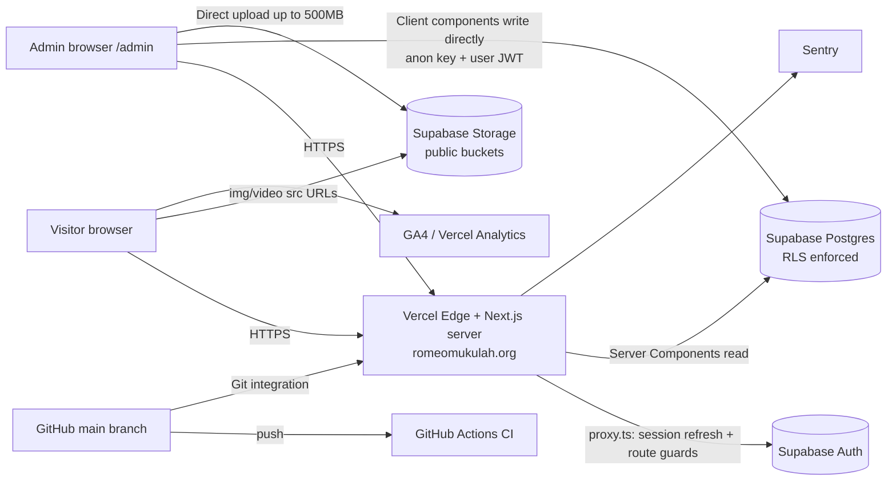

# Portfolio App — System Design

_Last analysed: 2026-11-18 (last code commit: 2026-01-29, `efd0e7d`)_

This document describes how the system works **as it is today**, and what has to change before
courses produced by **YTFactory** can be published on the site. It is written for two readers:

1. The owner, coming back to the project after ~10 months.
2. The YTFactory Claude session, which needs to know where course data and video files should go.

---

## 1. At a glance

| Layer | Technology | Notes |
|---|---|---|
| Framework | **Next.js 16.1.4** (App Router, Turbopack), **React 19.2** | `output: 'standalone'` (left over from Docker days) |
| Styling | Tailwind CSS 4, shadcn-style UI primitives, GSAP, lucide-react | |
| Database | **Supabase Postgres 17.6** — project ref `mrhqdnpypcdfovhztxrh` | Accessed directly from server *and* browser with the anon key + RLS |
| Auth | Supabase Auth (cookie sessions via `@supabase/ssr`) | |
| File storage | Supabase Storage (public buckets) | Images + raw video files |
| Hosting | **Vercel** (project `portfolio-app`, region `iad1`) | Domain: `https://romeomukulah.org` |
| CI/CD | GitHub Actions (`Mucrypt/portfolio-app`) + Vercel Git integration | |
| Monitoring | Sentry (`mukulah/javascript-nextjs`), Vercel Analytics + Speed Insights, GA4 | |
| Cache | Redis via `ioredis` — **disabled in production** (`REDIS_ENABLED` not set) | |
| Archived | AWS EKS / Terraform / Helm / Docker / nginx | All in `archived/aws/`; not in use |



---

## 2. Application structure

```
app/
  (public)/            Public site (Server Components, read from Supabase)
    page.tsx           Home
    about/ journey/ projects/ blog/[slug] services/[slug] shop/[slug] courses/[slug] contact/ archives/
  admin/               Owner-only CMS ('use client' layout; ~25 pages)
    courses/ blog/ projects/ shop/ services/ skills/ journey/ profile/ media/ users/ analytics/ ...
  api/                 Route handlers
    health, contact, blog/posts, blog/posts/[slug], analytics/ga4-data, analytics/realtime, cache/stats
  login/ signup/ account/ debug-auth/ sentry-example-page/
components/            public/, admin/ (ImageUpload, VideoUpload, DataTable, Sidebar), analytics/, ui/
lib/
  supabase/            client.ts (browser), server.ts (RSC), middleware.ts (session + guards), database.types.ts
  auth/                checkAdmin.ts (requireAdmin), AuthProvider.tsx, user.ts
  storage/             image-upload.ts, video-upload.ts (browser → Supabase Storage)
  redis/cache.ts       optional cache wrapper (off in prod)
  analytics/, utils/   GA4 helpers, activity logger, geolocation
proxy.ts               Next 16 "middleware" — calls updateSession()
supabase/migrations/   Hand-written SQL (applied manually in the SQL Editor — see §3.4)
archived/              Old SQL fixes, base schemas, seeds, AWS infra
```

### Data flow pattern

- **Reads (public):** Server Components call `createClient()` from `lib/supabase/server.ts` and query tables
  directly, filtered by `is_published = true`. RLS policies allow anonymous `SELECT` on published rows.
- **Writes (admin):** Admin pages are client components. They write straight to Supabase from the browser
  (`supabase.from('courses').insert/update/delete`). Security relies entirely on RLS
  (`auth.uid() = owner_user_id`). There is **no server-side API layer for writes** and **no service-role key**
  configured anywhere.
- **Uploads:** `lib/storage/*-upload.ts` upload directly from the browser to Supabase Storage and store the
  resulting public URL in a text column.

---

## 3. Database

### 3.1 Tables (public schema — 32 tables, 3 views)

| Domain | Tables |
|---|---|
| Owner profile / About | `profiles`, `profile_stats`, `about_page`, `about_sections`, `about_highlights`, `about_quotes`, `about_timeline`, `journey_content`, `skills`, `experiences`, `education`, `certificates`, `languages`, `sections`, `portfolio_sections` |
| Projects | `projects` (≈70 columns), `project_links`, `project_media` |
| Blog | `blog_posts`, `blog_categories`, `blog_comments`, `blog_post_views` |
| Services | `services` (≈90 columns), `service_inquiries`, `service_requests`, `service_reviews` |
| Shop | `shop_products` (affiliate/digital products) |
| **Courses** | **`courses`** (single flat table — see §3.3) |
| Visitors / users | `public_users`, `user_addresses`, `user_activity_log`, `contact_inquiries` |
| Views | `admin_pending_service_requests`, `admin_recent_inquiries`, `admin_user_stats` |
| Function | `get_public_user` |

Common conventions: `id uuid default gen_random_uuid()`, `owner_user_id uuid` (FK to `auth.users`),
`slug text unique`, `is_published bool`, `is_featured bool`, `sort_order int`, `created_at/updated_at timestamptz`,
arrays (`text[]`) for lists, `jsonb` for rich structures. Types are generated into
`lib/supabase/database.types.ts` via `npm run db:types`.

### 3.2 Auth & roles model

There are two kinds of users, both in `auth.users`:

| Role | How it's determined | Can do |
|---|---|---|
| **Owner / admin** (one person) | Has a row in `profiles` where `owner_user_id = auth.uid()` | Access `/admin/*`; RLS lets them write their own rows |
| **Public user** | Row in `public_users` (created on signup via trigger) | Required to view `/contact` and `/shop`; can submit inquiries/requests |

Guards live in `lib/supabase/middleware.ts` (`/admin` → must own a profile; `/contact`, `/shop` → must be logged in)
and again server-side in `lib/auth/checkAdmin.ts → requireAdmin()`.

> **Courses are currently public — no login needed, and there's no concept of enrollment or purchase.**

### 3.3 The `courses` table today (important for YTFactory)

The table was designed for **affiliate marketing** — listing other people's Udemy/Coursera courses and
sending visitors away via a link. It is **not** a course-hosting/LMS schema.

| Column | Type | Meaning today |
|---|---|---|
| `id`, `owner_user_id`, `slug` (unique), `title` | | |
| `short_description`, `description` (required) | text | |
| `thumbnail_url`, `promo_video_url` | text | |
| `gallery_images`, `lesson_videos` | text[] | Flat lists of URLs — no titles, order, duration, or sections |
| `instructor_name` (**required**), `platform` (**required**) | text | e.g. "Udemy" |
| `affiliate_link` (**required**, NOT NULL) | text | The detail page's main CTA button links here |
| `original_price`, `discounted_price`, `currency` | numeric/text | Display only — no payments |
| `duration_hours`, `level`, `category` (required), `language` | | |
| `rating`, `students_count` | | Manually entered "from platform" |
| `what_you_learn`, `requirements`, `tags` | text[] | |
| `is_featured`, `is_published`, `sort_order`, `created_at`, `updated_at` | | |

RLS: anyone can `SELECT` where `is_published = true`; the owner has full access to their rows.

**What is missing for self-made courses:** modules/sections, lessons (title, order, duration, video, transcript,
resources, free-preview flag), enrollments/progress, payments/access control, and a way for an external
tool to create courses automatically.

### 3.4 Schema management (how changes get applied)

- Base schemas live in `archived/database/*.sql` and `archived/supabase-sql/*.sql`.
- Later changes are in `supabase/migrations/*.sql`, but files are **not timestamp-named**
  (e.g. `add_video_fields_to_courses.sql`), so the Supabase CLI cannot track or replay them.
  They were pasted into the Supabase SQL Editor by hand.
- Root-level `seed_courses_with_videos.sql` and `SETUP_JOURNEY.sql` are one-off scripts.
- **The live database is the source of truth.** Before making changes, run `npm run db:pull` to capture the real
  schema, and then switch to timestamped migrations (`supabase migration new <name>`).

---

## 4. File storage

| Bucket | Public | Limit | Used for |
|---|---|---|---|
| `blog-images`, `shop-images`, `services-images`, `courses-images`, `projects-images`, `media-library` | yes | default | Images |
| `course-videos`, `blog-videos`, `project-videos`, `service-videos`, `media-videos` | yes | 500 MB, mp4/webm/ogg/mov/avi/mkv | Raw video files |

- Uploads go browser → Storage via `lib/storage/video-upload.ts` (client-side validation, metadata via HTML5 `<video>`).
- Videos are served as **raw files from a public URL** — no transcoding, no adaptive streaming (HLS/DASH),
  no signed URLs. Anyone with the URL can download them.
- Storage policies let **any authenticated user** (including public signups) upload/update/delete in these
  buckets — they're not restricted to the owner. That needs tightening before more content goes in.

---

## 5. Deployment & operations

### 5.1 Pipeline

```
git push main
  ├─► Vercel Git integration ─► build & deploy production (romeomukulah.org)
  └─► GitHub Actions
        ci.yml                 lint (non-blocking), tsc, build
        vercel-production.yml  test + audit, then deploy via CLI *if* VERCEL_TOKEN is set,
                               then curl /api/health
        security.yml           nightly npm audit + env checks
PRs ─► vercel-preview.yml      preview deploy + comment
release.yml                    manual tagged release
```

If `VERCEL_TOKEN` is set in GitHub secrets **and** the Vercel Git integration is on, `main` deploys **twice**.
Pick one.

Helper scripts: `npm run deploy "msg"` (commit + push + monitor), `npm run check`, `npm run status`,
`scripts/vercel-rollback.sh`, `scripts/health-check.sh`, `scripts/logs.sh`.

### 5.2 Environment variables

| Variable | Where | Purpose |
|---|---|---|
| `NEXT_PUBLIC_SUPABASE_URL`, `NEXT_PUBLIC_SUPABASE_ANON_KEY` | Vercel + `.env.local` | Supabase client |
| `SUPABASE_PROJECT_ID` | local | Type generation |
| `NEXT_PUBLIC_SITE_URL` | Vercel | Canonical URLs |
| `NEXT_PUBLIC_SENTRY_DSN`, Sentry auth token (`.env.sentry-build-plugin`) | Vercel / local | Error tracking + source maps |
| `NEXT_PUBLIC_GA_MEASUREMENT_ID` | Vercel | GA4 |
| `REDIS_ENABLED`, `REDIS_HOST`, `REDIS_PORT` | — | Cache (off in prod) |
| `AWS_*` | `.env.local` only | **Leftover from the archived AWS setup — rotate/delete these keys in AWS if they're still valid** |

`.env*` files are git-ignored (verified: not committed).

### 5.3 HTTP headers — two sets in conflict

Both `vercel.json` and `next.config.ts` set security headers on every route, with different values
(e.g. `X-Frame-Options: DENY` vs `SAMEORIGIN`). `vercel.json` also sets:

- `Cache-Control: public, max-age=31536000, immutable` on **every path, including HTML pages**. That can make
  browsers/CDNs keep stale pages for a year after you publish new courses.
- A CSP with **no `media-src` and no `frame-src`**, so they fall back to `default-src 'self'`. This blocks
  `<video src="https://…supabase.co/…">` and YouTube/Vimeo/Mux iframes.
- `Cross-Origin-Embedder-Policy: require-corp`, which also blocks cross-origin video/iframes that don't send
  CORP headers.

Check these on the live site first (`curl -I https://romeomukulah.org/courses`). They have to be fixed before
course video playback will work reliably.

---

## 6. Known issues found during analysis

| # | Severity | Issue | Where |
|---|---|---|---|
| 1 | High | Course detail page reads `params.slug` synchronously. In Next 16, `params` is a Promise, so the query gets `undefined` and **every course detail page 404s**. Blog/shop pages already use `await params`. | `app/(public)/courses/[slug]/page.tsx:41-48` |
| 2 | High | Global `Cache-Control: immutable` (1 year) on HTML routes | `vercel.json` |
| 3 | High | CSP/COEP block external video and embeds | `vercel.json` |
| 4 | High | Any signed-up public user can upload/delete files in all storage buckets | `supabase/migrations/create_storage_buckets.sql`, `create_video_storage_buckets.sql` |
| 5 | Medium | `courses` schema is affiliate-only (`affiliate_link`, `platform`, `instructor_name` NOT NULL); no lessons/modules | DB |
| 6 | Medium | Migrations are untracked/unordered; live DB may drift from repo | `supabase/migrations/` |
| 7 | Medium | Possible double deployments (Vercel integration + Actions) | `.github/workflows/vercel-production.yml` |
| 8 | Medium | Raw-file video hosting: 500 MB limit per file, Supabase egress costs, no adaptive streaming, easy to download | Storage |
| 9 | Low | Duplicate course pages: `page.tsx` = `new-page.tsx` (identical), plus `page-old.tsx` | `app/(public)/courses/` |
| 10 | Low | Two header configs (`vercel.json` vs `next.config.ts`); `output: 'standalone'` unneeded on Vercel | config |
| 11 | Low | `/admin` → `/admin/page` redirect in `vercel.json` looks wrong | `vercel.json` |
| 12 | Low | Lint is non-blocking (`npm run lint \|\| true`); no automated tests | CI |
| 13 | Low | Lots of overlapping docs in root and `docs/` (several deployment guides) | docs |

---

## 7. Integrating YTFactory courses — what has to be decided

### 7.1 Questions for the YTFactory session to answer

1. **Output format:** What does one finished course look like? (metadata JSON, list of modules/lessons, video
   files, thumbnails, transcripts/subtitles, quizzes, attachments.) How big is a typical lesson video, and how
   many courses and lessons are there?
2. **Where the videos are now:** Already on YouTube (public or unlisted)? Local MP4 files? Another CDN?
3. **Business model:** Free courses, paid courses, or free lessons with paid upgrades? This decides whether we need
   enrollments and payments (Stripe) and private video delivery.
4. **Sync model:** One-time bulk import, or should YTFactory keep pushing new or updated courses automatically?

### 7.2 Recommended direction (subject to the answers above)

**Video hosting** — don't put a large course library in public Supabase buckets.
- If the videos are on **YouTube already**: store the YouTube video ID per lesson and embed it. This is the
  cheapest and simplest option. It needs `frame-src https://www.youtube-nocookie.com` in the CSP.
- If courses are **paid** or must not be downloadable: use a streaming provider (Mux, Cloudflare Stream or
  Bunny Stream) with signed playback. Store the provider's asset/playback ID per lesson.

**Schema** — keep `courses` as the catalogue entry and add normalised tables:

```sql
-- courses: relax affiliate fields + mark origin
ALTER TABLE courses
  ALTER COLUMN affiliate_link DROP NOT NULL,
  ALTER COLUMN platform SET DEFAULT 'Own',
  ADD COLUMN course_type text NOT NULL DEFAULT 'affiliate'  -- 'affiliate' | 'own'
    CHECK (course_type IN ('affiliate','own')),
  ADD COLUMN source text,              -- e.g. 'ytfactory'
  ADD COLUMN external_id text UNIQUE,  -- YTFactory's course id → makes imports idempotent (upsert)
  ADD COLUMN access text NOT NULL DEFAULT 'free'  -- 'free' | 'paid' | 'members'
    CHECK (access IN ('free','paid','members'));

CREATE TABLE course_modules (
  id uuid PRIMARY KEY DEFAULT gen_random_uuid(),
  course_id uuid NOT NULL REFERENCES courses(id) ON DELETE CASCADE,
  title text NOT NULL, description text,
  sort_order int NOT NULL DEFAULT 0,
  external_id text, UNIQUE (course_id, external_id)
);

CREATE TABLE course_lessons (
  id uuid PRIMARY KEY DEFAULT gen_random_uuid(),
  course_id uuid NOT NULL REFERENCES courses(id) ON DELETE CASCADE,
  module_id uuid REFERENCES course_modules(id) ON DELETE CASCADE,
  slug text NOT NULL, title text NOT NULL, description text,
  sort_order int NOT NULL DEFAULT 0,
  duration_seconds int,
  video_provider text,        -- 'youtube' | 'mux' | 'cloudflare' | 'supabase'
  video_ref text,             -- provider id or URL
  thumbnail_url text,
  transcript text,            -- or captions_url
  resources jsonb DEFAULT '[]',  -- [{label,url,type}]
  is_free_preview boolean DEFAULT false,
  is_published boolean DEFAULT true,
  external_id text, UNIQUE (course_id, external_id), UNIQUE (course_id, slug)
);
-- Later, if paid/tracked: course_enrollments(user_id, course_id, status, purchased_at),
-- lesson_progress(user_id, lesson_id, completed_at, position_seconds)
```

RLS: public `SELECT` on published modules and lessons of published courses. Owner-only writes (same pattern as
`courses`). If paid access is added, the lesson's `video_ref` must only be returned to enrolled users. That means
the read moves server-side (signed URLs), not into a public column.

**Ingestion** — YTFactory should not write via the browser/anon-key path. Options, in order of preference:
1. **Import API route** `POST /api/ingest/courses`, protected by a shared secret (`INGEST_API_KEY`). It validates
   the payload with zod (already a dependency) and upserts by `external_id` using a server-only
   `SUPABASE_SERVICE_ROLE_KEY`. YTFactory calls it for each course. Re-running the import is safe.
2. **Import script** (`scripts/import-ytfactory.ts`) run locally against a JSON export with the service-role key.
   Simplest for a one-time bulk load.

**Frontend** — `/courses` lists both affiliate and own courses (badge by `course_type`).
`/courses/[slug]` shows the curriculum. New `/courses/[slug]/[lesson]` holds the player, lesson list and
progress. The CTA becomes "Start course" for own courses and "View on Udemy" for affiliate ones.
The admin courses page gets a curriculum editor, or stays read-only for YTFactory-sourced courses.

### 7.3 Suggested order of work

1. Pull the live schema (`npm run db:pull`) and adopt timestamped migrations.
2. Fix blockers: `await params` (#1), Cache-Control (#2), CSP/COEP for video (#3), storage policies (#4).
3. Agree on the YTFactory output contract (§7.1). Then add the schema (§7.2) and regenerate types (`npm run db:types`).
4. Build the ingest route or script and import one course end-to-end.
5. Build the curriculum and lesson pages. Then bulk-import.
6. (If paid) Add Stripe checkout, enrollments, and signed video playback.
7. Clean up: remove duplicate course pages, choose one deploy path, consolidate the docs.
